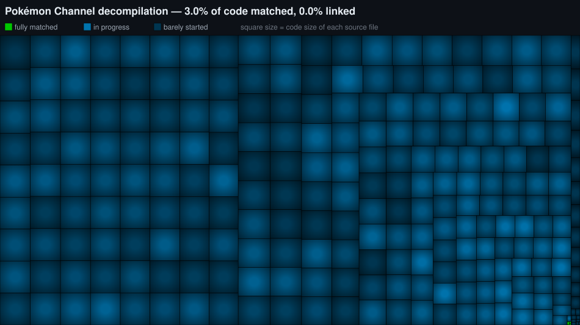

# Pokémon Channel — Decompilation

An early-stage matching decompilation of **Pokémon Channel** (GameCube, USA, `GPAE01`).

The goal is C source code that compiles, with the original Metrowerks CodeWarrior compiler, to a
byte-identical copy of the retail game executable (`main.dol`).

This repository contains **no game assets, ROMs, ISOs or executables**. You need your own legally obtained
copy of the game to build it.

## Progress

[](progress.svg)

Each square is one source file, sized by how much code it contains. Click the map for an interactive
version where hovering a square shows the file name and how much of it matches.

| | |
|---|---|
| Functions that match byte for byte | 930 of 5264 |
| Code matched (bytes in those functions) | 3.0% |
| Overall similarity of the drafted code to the original ("fuzzy" match) | 34.9% |
| Functions with a real name | 1983 of 5264 |
| Complete files linked into the build | none yet |

Last updated 2026-11-11.

## How this code was produced

**Everything in `src/` so far is the output of an automated script pipeline. None of it was written by hand,
and none of it was written by an AI model.** The steps, all run unattended:

1. **Analysis.** [decomp-toolkit](https://github.com/encounter/decomp-toolkit) analyses `main.dol` and finds
   the functions and data (`config/GPAE01/symbols.txt`, `splits.txt`).
2. **Splitting.** A script cuts the code into units of roughly 32 functions each. The original file
   boundaries are not known yet, which is why the files are called `t<address>.c`.
3. **First drafts.** [m2c](https://github.com/matt-kempster/m2c) translates each function's assembly into C.
   A script then repairs the result mechanically until the real compiler accepts it: it declares missing
   identifiers, comments out statements that do not compile, and replaces a function with a stub when
   nothing else works. Those places are marked in the source (`/* draft: did not compile */`,
   `/* draft: stub */`).
4. **Compiler selection.** The drafts are scored under every available CodeWarrior version and the best one
   is kept (CodeWarrior GC/1.3).
5. **Automated search.** Rule-based source rewrites, a register-allocation solver and
   [decomp-permuter](https://github.com/simonlindholm/decomp-permuter) try variations of each function. A
   variation is kept only if the compiled bytes get closer to, or equal to, the original; every kept result
   is compiled and compared again before it is written.
6. **Names.** Function names were assigned by scripts as well, from three sources: the game's own script
   engine table (which binds each native function to the name its scripts call it by; these are the
   `scr_...` functions and the functions behind them), byte comparison with compiled objects of the
   [Super Smash Bros. Melee decompilation](https://github.com/doldecomp/melee) (the game uses HAL's
   sysdolphin library), and byte comparison with already-named SDK and runtime functions of other GameCube
   games. Everything else is still `fn_<address>`.

The scripts and the know-how behind steps 3 to 5 are published separately as a
[matching-decompilation toolkit](https://github.com/imyourhuckleberryponcho/Decomp-Toolkit).

### What that means for the code you see here

- It reads like machine output, because it is: `temp_r3` variables, `M2C_UNK` types, raw pointer offsets
  instead of structs, labels instead of loops in places.
- A function that is counted as matched compiles to the original bytes, but nobody has reviewed it for
  meaning yet.
- Names taken from near (not exact) byte matches are best guesses.
- Files are arbitrary chunks of the executable, not the original source files.

Human work (real types, structs, file boundaries, readable code) starts from this base.

## Building

### Requirements

- Python 3.9+
- [Ninja](https://ninja-build.org/) 1.3+
- Windows, Linux or macOS (on non-Windows hosts the original compilers run through
  [wibo](https://github.com/decompals/wibo) or Wine; the build downloads what it needs)

### Steps

1. Clone the repository.

2. Extract `sys/main.dol` from your copy of the game (USA, `GPAE01`) and place it at
   `orig/GPAE01/sys/main.dol`. Any GameCube disc extraction tool (e.g. Dolphin's "Extract System Data")
   works.

3. Configure and build:

   ```
   python configure.py
   ninja
   ```

   The build ends with a progress report. No source file is linked into the final executable yet, so
   `build/GPAE01/main.dol` is still assembled from the original code and the check against the retail
   executable passes for that reason.

## Repository layout

| Path | Contents |
|---|---|
| `src/game/` | Drafted C source, one file per chunk of the executable |
| `include/` | The small shared header the drafts use, and m2c's helper macros |
| `config/GPAE01/` | Symbol map, file splits, unit list and compiler setting for the USA version |
| `configure.py` | Lists every source file and whether it currently matches |
| `tools/` | Build tooling (from the decomp-toolkit project template) |

## Contributing

Pick a function from `build/GPAE01/report.json`, improve its C, and compare the compiled object with the
original using [objdiff](https://github.com/encounter/objdiff) (`objdiff.json` is generated by
`configure.py`). A function only counts once it matches byte for byte.

## About the original game

Pokémon Channel was developed by Ambrella and published by Nintendo and The Pokémon Company (2003).
Pokémon is a trademark of Nintendo, Creatures Inc. and GAME FREAK inc.

## Acknowledgements

- [decomp-toolkit](https://github.com/encounter/decomp-toolkit) and its project template, and
  [objdiff](https://github.com/encounter/objdiff)
- [m2c](https://github.com/matt-kempster/m2c) and
  [decomp-permuter](https://github.com/simonlindholm/decomp-permuter)
- The [Super Smash Bros. Melee decompilation](https://github.com/doldecomp/melee), whose sysdolphin
  function names were matched against this game

## Legal

This project is not affiliated with or endorsed by Nintendo, The Pokémon Company, Ambrella, Creatures or
GAME FREAK. It contains no copyrighted game data; the source code is an independent reconstruction for
interoperability and preservation. Released under CC0 1.0 (see `LICENSE`).
